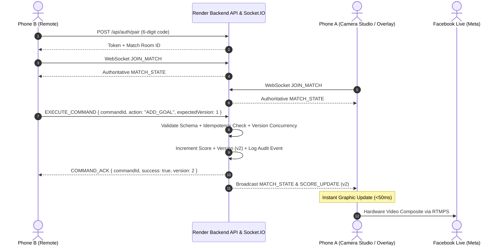

# 🏟️ Pro Football Live Studio — Architecture & Technical Feasibility

## 1. PHASE 0 — Technical Feasibility Study

### 1.1 The Fundamental Challenge of Mobile Browser Streaming
A web application executing in mobile browsers (iOS Safari, Android Chrome) cannot directly open arbitrary TCP sockets to Facebook Live's `rtmps://live-api-s.facebook.com:443/rtmp/` because:
1. Browser JavaScript standard APIs only expose HTTP/HTTPS, WebSockets, and WebRTC. Native TCP / RTMP packet creation is blocked by browser sandboxing.
2. Background execution: If the user locks the screen or switches to another mobile application, mobile operating systems immediately pause or terminate `requestAnimationFrame`, `getUserMedia`, and HTML5 Canvas rendering.
3. Thermal and battery constraints: Software video encoding (e.g., encoding 720p 30fps frames on an HTML5 canvas via software WebCodecs or WebM MediaRecorder) generates high CPU heat and drains battery rapidly compared to dedicated hardware H.264 encoders (NVENC, Apple VideoToolbox, Qualcomm MediaCodec).

### 1.2 Comparison of Streaming Architectures

| Criteria | Option A: Native Streaming App (Larix Broadcaster) | Option B: Mobile Browser Canvas + Web Gateway | Option C: OBS Studio Fallback (PC) |
| :--- | :--- | :--- | :--- |
| **Phone A Direct Capture** | ✅ Yes (Native hardware camera API) | ✅ Yes (`navigator.mediaDevices.getUserMedia`) | ⚠️ Requires phone-to-PC link (DroidCam/VDO.ninja) |
| **Scoreboard & Sponsor Burn-in** | ✅ Yes (Supports transparent Web Overlay URL via internal WebView) | ✅ Yes (HTML5 Canvas composite in browser) | ✅ Yes (OBS Browser Source 1280x720) |
| **Phone B Remote Control** | ✅ Yes (Real-time WebSocket updates overlay) | ✅ Yes (WebSocket updates canvas composite) | ✅ Yes (WebSocket updates OBS overlay) |
| **External Software Needed** | Larix Broadcaster (Free on iOS & Android) | None (Browser only + server gateway) | OBS Studio on Windows/Mac/Linux |
| **Cost / Licensing** | 100% Free (Larix core streaming & Web Layers are free) | 100% Free | 100% Free & Open Source |
| **Background / Lock / Battery** | ⭐ Excellent (Native hardware encoder, OS background audio support) | ⚠️ Sensitive (Cannot lock screen; high CPU) | ⭐ Excellent (PC handles encoding load) |
| **Feasibility & Production Grade** | **PRIMARY RECOMMENDED ZERO-PC SETUP** | **BUILT-IN WEB STUDIO PREVIEW / BACKUP** | **PRIMARY STUDIO WORKSTATION SETUP** |

### 1.3 Selected Production Architecture
Pro Football Live Studio v2 implements a **dual-pipeline unified architecture**:
1. **The Core Real-Time Graphics Engine (`/overlay`):**
   A transparent sports broadcast renderer served via WebSocket that connects directly into **Larix Broadcaster on Phone A** (no PC required) OR **OBS Studio on PC** (studio fallback).
2. **The In-Browser Studio (`/studio`):**
   A complete browser-based composite studio combining `getUserMedia` video, audio, and HTML5 Canvas overlays with live preview, connection diagnostics, and test recording.
3. **The Mobile Remote Control (`/remote`):**
   A zero-install touch-optimized remote control for Phone B communicating via Socket.IO with authoritative server-state validation and idempotency protection.

---

## 2. Monorepo Structure

```
pro-football-live-studio/
├── client/                     # Vite + React 18 + TypeScript SPA
│   ├── src/
│   │   ├── pages/             # StudioPage, RemotePage, OverlayPage, Tournaments, Sponsors
│   │   ├── components/        # Reusable UI widgets and modals
│   │   ├── features/
│   │   │   ├── live-studio/   # Camera preview & controls
│   │   │   ├── remote-control/# Score, clock, cards, scenes, sponsors, tickers
│   │   │   ├── scoreboard/    # High-definition broadcast overlays
│   │   │   ├── tournament/    # Match schedules & teams
│   │   │   └── sponsors/      # Logo & banner carousel management
│   │   └── lib/               # socketClient, api, canvasEngine
├── server/                     # Node.js + Express + Socket.IO Server
│   ├── src/
│   │   ├── routes/            # REST API endpoints (/api/matches, /api/auth, etc.)
│   │   ├── services/          # Authoritative matchService, streamGateway, auditService
│   │   ├── websocket/         # socketServer, matchRoomHandler, idempotencyStore
│   │   ├── auth/              # JWT, bcrypt, pairingCodeManager
│   │   ├── database/          # DatabaseAdapter (GoogleSheetsAdapter & JsonFileAdapter)
│   │   └── middleware/        # Auth, rateLimiting, error handling
├── shared/                     # Shared TypeScript contracts
│   ├── types/                 # Match, Tournament, Sponsor, Socket, User types
│   ├── schemas/               # Zod validation schemas
│   └── events/                # Socket event constants
├── scripts/
│   └── setup-database.ts      # Automated Google Sheets & local schema initialization
├── docs/                      # Comprehensive technical documentation
│   ├── architecture.md
│   ├── streaming-setup.md
│   ├── deployment.md
│   └── testing.md
├── render.yaml                 # Render cloud hosting blueprint
└── package.json               # Root monorepo workspace configuration
```

---

## 3. Real-Time Remote Control Flow



---

## 4. State Authoritativeness & Idempotency
- **No Independent Client Calculation**: Scores, periods, and timers are managed strictly on the server. If Phone B experiences network packet retransmissions, duplicate requests bearing the same `commandId` are resolved from `IdempotencyStore` without altering the match score twice.
- **Drift-Free Clock**: The server tracks `lastStartedTimestamp` and accumulated seconds. Periodic ticks synchronize clients so both Phone A and Phone B display synchronized match timers.
- **Optimistic Concurrency**: Commands transmit `expectedVersion`. If another operator has altered state, the server rejects outdated commands with `VERSION_MISMATCH` and forces a clean state resync.
